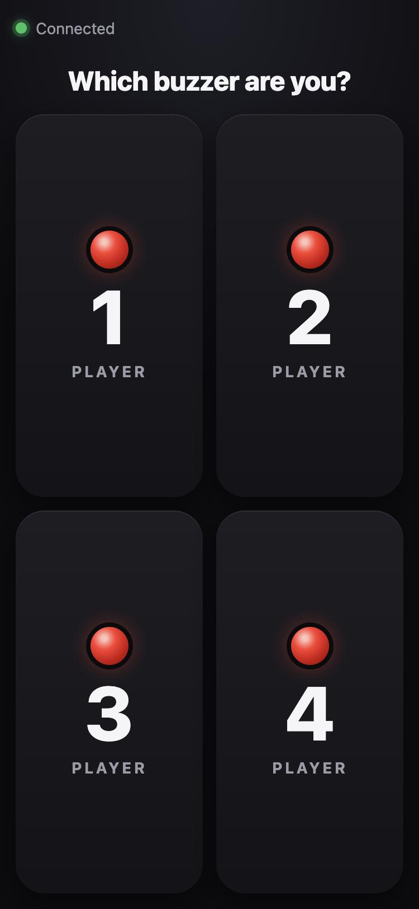
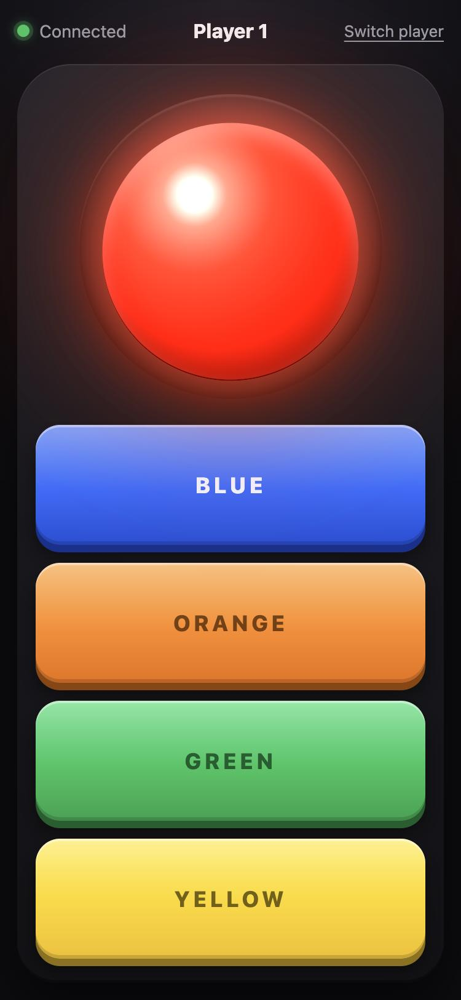

# Phone Buzzers for PCSX2 (Buzz!)

[](https://github.com/sgassner/pcsx2-phone-buzzers/actions/workflows/tests.yml)

Play the **Buzz!** quiz games in the PS2 emulator [PCSX2](https://pcsx2.net) without the original buzzers:
up to 4 players open a web page on their **phones** and use them as buzzers. A small server on your
computer turns the button presses into key presses that PCSX2 understands as a **Buzz Controller**.

<p align="center">
  
  &nbsp;&nbsp;&nbsp;
  
</p>

- Works on **macOS** and **Windows**; phones just need a browser (iPhone or Android), no app.
- Big red buzzer plus the four answer buttons (blue, orange, green, yellow) like the original.
- Real **press and hold** – the key stays down as long as your finger does.
- **No stuck keys:** if a phone loses Wi-Fi, locks or the server is stopped, every held key is released.
- Several phones may pick the same player; the terminal shows who is connected.
- Free and open source ([MIT license](LICENSE)).

## Contents

1. [What you need](#what-you-need)
2. [Setup on macOS](#setup-on-macos)
3. [Setup on Windows](#setup-on-windows)
4. [Connect the phones](#connect-the-phones)
5. [Set up PCSX2](#set-up-pcsx2)
6. [Playing](#playing)
7. [Troubleshooting](#troubleshooting)
8. [Customizing](#customizing)
9. [How it works](#how-it-works)

## What you need

- **PCSX2** (version 2.x) with a Buzz! game that you own.
- A **Mac or Windows PC** that runs PCSX2.
- **Python 3.9 or newer** – the start file sets up everything else by itself.
- **Phones on the same Wi-Fi** as the computer.

## Setup on macOS

1. **Download** [`pcsx2-phone-buzzers-mac.zip`](https://github.com/sgassner/pcsx2-phone-buzzers/releases/latest/download/pcsx2-phone-buzzers-mac.zip)
   and double-click it to unzip.
2. **Python:** if you don't have Python 3.9+ yet, install it from [python.org/downloads](https://www.python.org/downloads/).
3. **Double-click `Start Buzz (Mac).command`.** A Terminal window opens. The first start installs what's
   needed (about a minute, needs internet); after that it starts right away.

   > **"Apple could not verify…" / "cannot be opened"?** That's because the file comes from the internet.
   > Click *Done*, open **System Settings → Privacy & Security**, scroll down and click **Open Anyway**
   > next to `Start Buzz (Mac).command`. You only have to do this once.

4. **Allow key presses (important!):** open **System Settings → Privacy & Security → Accessibility**
   and turn on **Terminal**. Without this, no key presses reach PCSX2. Then close the Terminal window
   and double-click the start file again. (The server warns you at startup if the permission is missing.)
5. **Firewall:** if macOS asks whether *python* may accept incoming network connections, click **Allow**.

## Setup on Windows

1. **Download** [`pcsx2-phone-buzzers-windows.zip`](https://github.com/sgassner/pcsx2-phone-buzzers/releases/latest/download/pcsx2-phone-buzzers-windows.zip),
   right-click it → **Extract All…** (it doesn't work from inside the zip).
2. **Python:** if you don't have Python 3.9+ yet, install it from [python.org/downloads](https://www.python.org/downloads/)
   and tick **"Add python.exe to PATH"** in the installer.
3. **Double-click `Start Buzz (Windows).bat`.** A console window opens. The first start installs what's
   needed (about a minute, needs internet); after that it starts right away.

   > **"Windows protected your PC"?** Click **More info → Run anyway**. That appears because the file comes
   > from the internet.

4. **Firewall:** when Windows Defender Firewall asks, allow access on **Private networks**. Your Wi-Fi must be set
   to *Private* (Settings → Network & internet → Wi-Fi → your network → Network profile type: **Private network**).

No extra permission is needed on Windows. Don't run PCSX2 **as administrator** – Windows then blocks
simulated key presses from normal programs.

## Connect the phones

The terminal window shows the address in big letters and as a QR code:

```
  BUZZ!  Phone buzzers for PCSX2  v1.0.0

  Open this on the phones (same Wi-Fi):

  ▄█  █▀█ ▀▀█   ▄█  █▀▀ █▀█   ▄█    ▀▀█ ▀▀█ ▄ █▀█ █▀█ █▀█ █▀█
   █  ▀▀█ █▀▀    █  █▀█ █▀█    █    █▀▀  ▀█ ▄ █▀█ █ █ █ █ █ █
  ▀▀▀ ▀▀▀ ▀▀▀ ▀ ▀▀▀ ▀▀▀ ▀▀▀ ▀ ▀▀▀ ▀ ▀▀▀ ▀▀▀   ▀▀▀ ▀▀▀ ▀▀▀ ▀▀▀

  →  http://192.168.1.23:8000
```

1. On each phone, **scan the QR code** with the camera or type the address into the browser.
2. Tap **Player 1, 2, 3 or 4**. The phone remembers its player; *Switch player* (top right) changes it.
3. The dot at the top left shows the connection: **green** = connected, **red** = reconnecting (happens automatically).

Tip: *Add to Home Screen* (Safari share menu / Chrome menu) opens the buzzer full screen without the address bar.

## Set up PCSX2

You only need to do this once – PCSX2 remembers the bindings.

1. Start the server (see above) and open PCSX2.
2. In PCSX2 open **Settings → Controllers**.
3. On the left, click **USB Port 1**.
4. Set **Device Type** to **Buzz Controller**.
5. Under **Bindings** you now see 20 fields: **Player 1 Red, Player 1 Blue, Player 1 Orange, Player 1 Green,
   Player 1 Yellow**, and the same for Players 2–4.
6. Click a field, e.g. **Player 1 Red**. PCSX2 waits a few seconds for input – press the **red buzzer on the
   phone of player 1** (or the matching key on the keyboard, see the table). The field now shows the key.
7. Repeat for all fields (you can skip the players you don't need). Right-click a field to clear it.
8. Close the window and start your Buzz! game.

Binding by pressing the phone buttons is the easiest way – PCSX2 simply records the key that arrives.
These are the keys the server uses (changeable, see [Customizing](#customizing)):

| Player | Red | Blue | Orange | Green | Yellow |
|:------:|:---:|:----:|:------:|:-----:|:------:|
| 1 | `1` | `q` | `a` | `y` | `x` |
| 2 | `2` | `w` | `s` | `c` | `v` |
| 3 | `3` | `e` | `d` | `b` | `n` |
| 4 | `4` | `r` | `f` | `m` | `,` |

The server reads your keyboard layout (QWERTY, QWERTZ, …) and presses exactly the key labelled with
that character, so binding with the real keyboard gives the same result. `1`–`4` always come from the
number row, never from the numeric keypad.

## Playing

- **The PCSX2 game window must be in front** (focused) – key presses always go to the active window.
  Click into the game window once after setting things up.
- Leave the server's terminal window open while you play. **Ctrl+C** or closing the window stops it;
  all held keys are released.
- The terminal logs who connects and every button press – handy to check that the phones get through.

## Troubleshooting

| Problem | Solution |
|---|---|
| Phone can't open the page | Same Wi-Fi as the computer? Guest networks often block devices from each other. Allow the firewall prompt (Windows: *Private* network). Turn off a VPN or allow "local network access" in it. Try the second address the terminal shows under "if that doesn't work". |
| Page works, but nothing happens in PCSX2 | **macOS:** allow *Terminal* under Accessibility (see setup) and restart the server. **All:** click into the PCSX2 window so it is in front; check the bindings in *Settings → Controllers → USB Port 1*. If the terminal logs the presses, the phones are fine. |
| Windows: keys don't arrive although the terminal logs them | PCSX2 is probably running as administrator – start it normally. |
| macOS: start file "cannot be opened" | System Settings → Privacy & Security → **Open Anyway** (see setup). |
| "Port 8000 is already in use" | The server is already running in another window – or start it on another port: `python3 buzz.py --port 8001`. |
| Phone screen turns off during the game | Set a longer auto-lock time on the phone. |
| iPhone doesn't vibrate | Normal – iPhones don't allow vibration from web pages. The button lights up instead. |

Test mode: `python3 buzz.py --dry-run` (Windows: `py buzz.py --dry-run`) only shows the button presses in the
terminal and presses no keys – useful to test the phones without PCSX2.

## Customizing

Open `buzz.py` in a text editor. At the top you find:

- `KEYMAP` – which key each button presses. Special keys work by name, e.g. `"space"`, `"enter"`, `"up"`, `"f1"`.
  Use keys that need no Shift/AltGr. After changing it, bind the buttons in PCSX2 again.
- `PORT` – the server port (default `8000`), or start with `--port 8001`.
- `LOG_BUTTONS` – set to `False` to stop logging every button press.

### Running from the command line

Instead of the start files you can install the requirements yourself:

```bash
pip3 install -r requirements.txt   # Windows: py -m pip install -r requirements.txt
python3 buzz.py                    # Windows: py buzz.py
```

Options: `--port 8001`, `--dry-run`, `--version`, `--help`.

## How it works

```
Phone (web page)  ──WebSocket──▶  buzz.py on your computer  ──key down/up──▶  PCSX2 (Buzz Controller)
 {"player": 1, "button": "red", "state": "down"}               holds "1" until "up" arrives
```

- `buzz.py` is a single Python file: a web server ([aiohttp](https://docs.aiohttp.org)) that also serves
  the phone page, and [pynput](https://pynput.readthedocs.io) for the key presses. [qrcode](https://pypi.org/project/qrcode/)
  draws the QR code in the terminal (optional).
- Keys are held, not tapped: *down* presses the key, *up* releases it. If two phones hold the same key, it is
  released once both let go.
- Against stuck keys: the server notices a phone that went silent within about 5 seconds (heartbeat) and releases
  its keys; the page releases buttons when it is hidden (call, app switch); stopping the server releases everything.
- **Security:** anyone on your Wi-Fi who opens the page can press the 20 configured keys – nothing else.
  Other websites can't connect to the server. Only run it on networks you trust and stop it after playing.

Run the tests with `python tests/test_buzz.py` (they press no real keys).

## License & disclaimer

[MIT](LICENSE) – free to use, change and share.

This is a fan project and not affiliated with Sony Interactive Entertainment or the PCSX2 team.
"Buzz!" is a trademark of Sony Interactive Entertainment. You need your own legally obtained game and PS2 BIOS.
